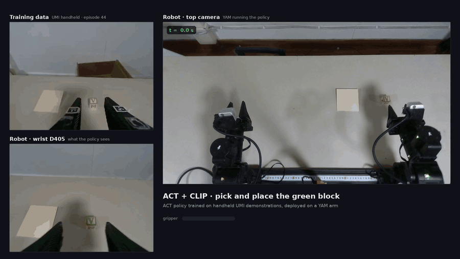
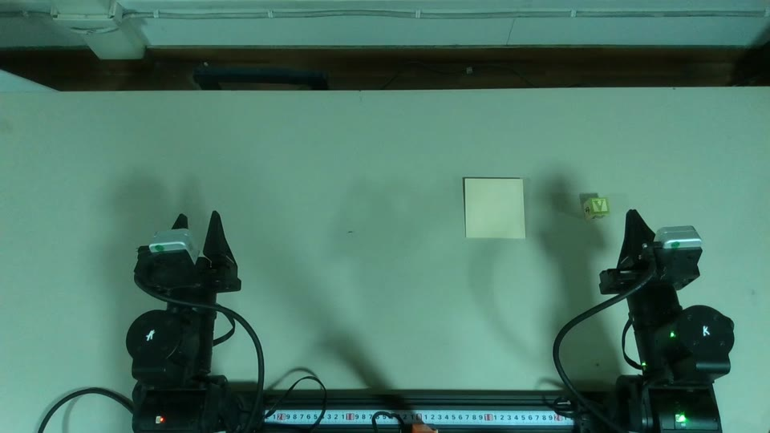
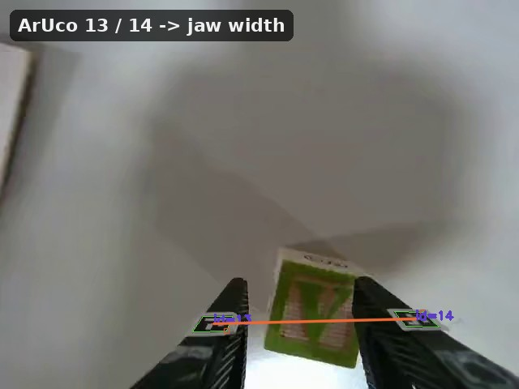
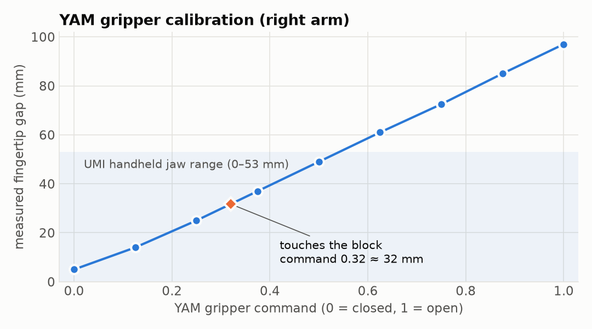
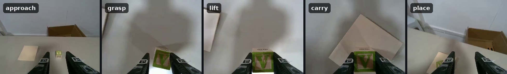
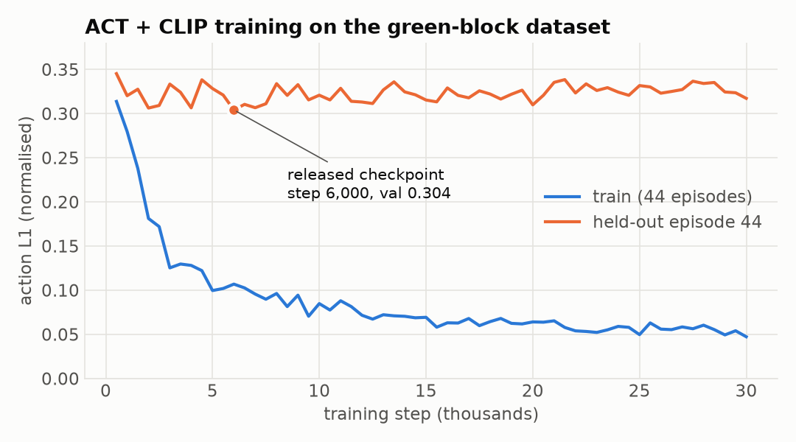
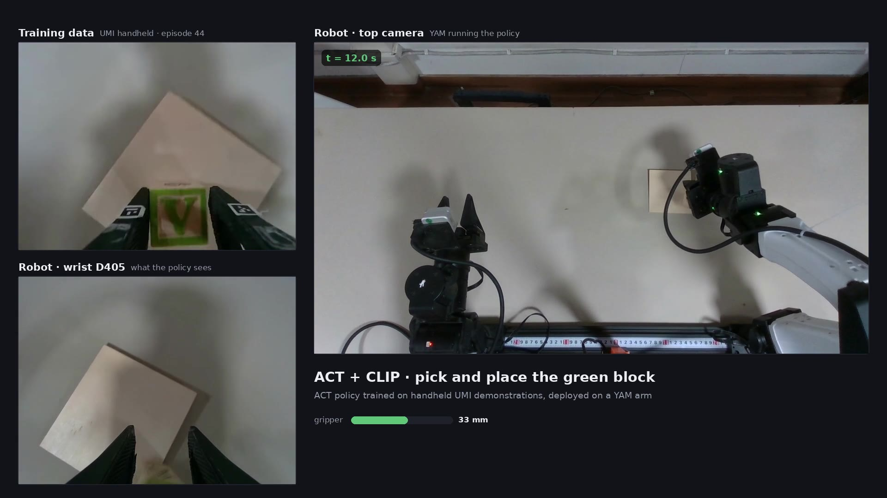
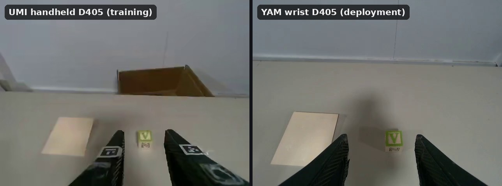

# yumi: handheld UMI demonstrations → policies on a YAM arm

yumi records manipulation demonstrations with a **handheld gripper** that has a
D405 wrist camera and a T265 tracker on it (a [UMI](https://umi-gripper.github.io/)-style
rig without ROS). It turns them into **LeRobot v3** datasets of relative end-effector
trajectories, trains ACT policies on them, and runs those policies on a **YAM arm**
through [Karma](https://github.com/SRA-VJTI/karma).

<p align="center">
  <a href="assets/blog.mp4"></a>
</p>
<p align="center"><sub>
Left top: a training demonstration from the handheld gripper. Left bottom and right: the YAM arm running the
ACT + CLIP policy, seen from its wrist D405 and the top D435. Real time, 18 s. Full-resolution videos: <a href="assets/blog.mp4">merged</a> · <a href="assets/rollout-top-wrist.mp4">top + wrist</a> · <a href="assets/training-demo.mp4">training demo</a>.
</sub></p>

| Stage | What happens | Main command |
|---|---|---|
| [1. Calibrate](#2-calibration) | Jaw width from finger markers, YAM gripper gap table | `calibrate_width_four_points.py`, `measure_yam_gripper.py` |
| [2. Collect](#3-data-collection) | Handheld demos: wrist video, T265 pose, jaw width | `yumi record-session` |
| [3. Export](#4-export-to-lerobot) | UMI relative-trajectory LeRobot v3 dataset | `export_umi_lerobot.py` |
| [4. Train](#5-training) | ACT / ACT + CLIP on 50-step relative chunks | `training/train_v2.py` |
| [5. Roll out](#6-robot-rollout) | Policy drives the YAM arm, optionally recorded | `infer_act_relative.py live` |
| [6. Record](#7-recording-a-rollout-video) | Demo + wrist + top camera merged into one video | `make_rollout_video.py` |

---

## Contents

- [Hardware](#hardware)
- [1. Setup](#1-setup)
- [2. Calibration](#2-calibration)
- [3. Data collection](#3-data-collection)
- [4. Export to LeRobot](#4-export-to-lerobot)
- [5. Training](#5-training)
- [6. Robot rollout](#6-robot-rollout)
- [7. Recording a rollout video](#7-recording-a-rollout-video)
- [Results so far](#results-so-far)
- [Troubleshooting](#troubleshooting)
- [Repository layout](#repository-layout) · [Further docs](#further-docs)

---

## Hardware

| Part | Model | Serial (SDK) | Role |
|---|---|---|---|
| Handheld wrist camera | RealSense D405 | `352122273221` | Training images, 640×480 @ 30 fps |
| Handheld tracker | RealSense T265 | `943222111495` | 6-DoF pose of the handheld gripper |
| Finger markers | ArUco `DICT_4X4_50`, IDs **13** (left) and **14** (right), 10 mm | — | Jaw width from marker separation |
| Robot | Right arm of the bimanual YAM rig, E_Yam gripper | CAN `can_right` | Policy execution |
| Robot wrist camera | RealSense D405 | `352122271723` (ASIC `254623070417`) | The policy's only input at deployment |
| Top camera | RealSense D435 | `243622071623` (ASIC `348523020354`) | Scene view for recordings, not a policy input |
| Left wrist camera | RealSense D405 | `409122274921` | Unused by these policies |

The handheld body is printable from `tinyumi_D405_T265_NO_QUEST_assembly.stl`
(sources in `tinyumi_D405_T265_NO_QUEST_final.zip`). Print the marker and board
targets with the [Print & Calibration Guide](CALIBRATION_PRINT_GUIDE.md).

<p align="center">
  <br>
  <sub>The deployment scene from the top D435: green block, wooden board, and the bimanual YAM rig (the policy uses the right arm).</sub>
</p>

> Karma takes the **ASIC** serial (`--camera-serial`); the yumi scripts take the
> **SDK** serial (`--serial`). Mixing them up is the most common camera error.

---

## 1. Setup

Two checkouts side by side, each with its own uv environment:

```
~/yumi    this repo: capture, calibration, export, training scripts, inference
~/karma   robot stack: YAM drivers, CAN, IK, safety, LeRobot 0.6.1, viser
```

| Environment | Python | Used for |
|---|---|---|
| `~/yumi` (`uv sync`) | 3.10, `pyrealsense2==2.53.1` | Anything that touches the **T265**: handheld capture and jaw-width calibration. Newer SDKs dropped T265 support. |
| `~/karma` (`uv sync`) | 3.12/3.13, LeRobot 0.6.1 | Everything that touches the **robot** or **LeRobot**: export, offline evaluation, inference, gripper calibration, recording. Run as `cd ~/karma && uv run python ../yumi/scripts/<script>.py`. |

### yumi

```bash
git clone <this repo> ~/yumi && cd ~/yumi
uv sync --locked --extra dev
```

Install the RealSense 2.53.1 udev rules once and replug the cameras (the T265
enumerates twice, as `03e7:2150` and then `8087:0b37`):

```bash
mkdir -p research
curl -fL https://raw.githubusercontent.com/realsenseai/librealsense/v2.53.1/config/99-realsense-libusb.rules \
  -o research/99-realsense-libusb.rules
sudo install -m 644 research/99-realsense-libusb.rules /etc/udev/rules.d/
sudo udevadm control --reload-rules && sudo udevadm trigger --subsystem-match=usb
uv run yumi devices          # lists every RealSense with its serial
```

Pinned versions and why are in the [capture reference](docs/capture-reference.md#compatibility).

### Karma

[Karma](https://github.com/SRA-VJTI/karma) is the robot control stack for the
YAM arms. yumi doesn't vendor it; the robot-side scripts import it from Karma's
environment. What yumi uses from it, and how to set it up, is in
**[docs/karma.md](docs/karma.md)**. In short:

```bash
git clone https://github.com/SRA-VJTI/karma ~/karma && cd ~/karma
sudo ./scripts/install_build_deps_ubuntu.sh
./scripts/build_deps.sh
UV_HTTP_TIMEOUT=180 uv sync --locked
git clone https://github.com/i2rt-robotics/i2rt.git     # YAM MJCF for IK, git-ignored
uv run karma-viz --fetch-meshes --model Yam

# CAN buses (pinned names: see karma docs/yam-setup.md)
sudo ip link set can_right up type can bitrate 1000000
sudo ip link set can_left  up type can bitrate 1000000
uv run karma doctor --rig yam_bimanual --interface-override right=can_right --probe
```

The ACT + CLIP checkpoint also needs `transformers`. Add it per command with
`uv run --with transformers --with huggingface_hub==1.28.0 ...`, as in the
commands below; Karma's lockfile stays untouched.

---

## 2. Calibration

Three things are calibrated: **jaw width** on the handheld gripper, the **YAM
gripper's gap** against its command, and which **camera** is which. The tracker-to-gripper
transform is currently an assumed rotation, not a measurement (see
[known gaps](#known-gaps)).

### 2.1 Handheld jaw width (finger markers)

The jaw width comes from the pixel distance between ArUco markers 13 and 14 on the
fingers. A ruler calibration maps that distance to millimetres.

<p align="center"></p>

Check that both markers decode across the whole opening range:

```bash
cd ~/yumi
uv run yumi preview-markers --config configs/umi.yam-collection.json   # http://localhost:8080
```

Then run the four-point ruler calibration: jaws touching, two gaps in between, and
fully open. It writes a new config with a piecewise-linear fit:

```bash
uv run python scripts/calibrate_width_four_points.py --config configs/umi.yam-collection.json
```

The current fit (`data/calibration/width-20261007-recalibration.json`) covers
**0–53 mm**. Widths outside the measured range are rejected rather than
extrapolated. The full live calibration flow (`calibrate-width-live`,
`width-console`, `fit-width`) and the tracker/board calibration are in the
[capture reference](docs/capture-reference.md#calibrate-capture-convert) and
[calibration notes](docs/calibration.md).

### 2.2 YAM gripper gap

The policy predicts a physical jaw width in metres. To command the YAM gripper
to that same gap, measure the YAM fingertip gap with calipers at each gripper command:

```bash
cd ~/karma
uv run python ../yumi/scripts/measure_yam_gripper.py
```

- The arm is energized and held still; only the gripper moves.
- At each command (1.0, 0.875, …, 0), measure the gap between the **inner faces
  of the fingertips** and type it in mm. Press Enter to skip a step where the jaws
  already touch; the gaps must strictly increase.
- Then a touch test: hold the block between the fingers, press Enter as it closes,
  and type `t` when the fingers touch it.

It writes `configs/yam.gripper-width.json`, which inference reads with
`--gripper-calibration`. Commands are interpolated from the table; widths beyond
the measured ends are clamped to them.

<p align="center"></p>

### 2.3 Identify the wrist cameras

Cover one gripper's camera and watch which serial goes dark. The script is in
[act-relative-policy.md §5](docs/act-relative-policy.md#rig). The right wrist is
`352122271723`.

---

## 3. Data collection

Demonstrations are recorded in a **persistent session**: the D405, T265 (and
optionally the top D435) stay open, and each episode is started and stopped from
the terminal.

```bash
cd ~/yumi
uv run yumi record-session \
  --config configs/umi.yam-collection.json \
  --output "data/lerobot/session-$(date +%Y%m%d-%H%M%S)" \
  --episodes 25 --warmup 30 --require-valid-width \
  --task "Pick up the green block and place it on the wooden board"
```

1. Open **http://localhost:8080** (or the machine's LAN address). Move the
   gripper gently during the 30 s warm-up until tracking reaches confidence 3/3.
2. Reset the scene, hold the gripper in the start pose, and press **Space** to
   start. Recording starts only after one second of fresh pose and a valid jaw width.
3. Do the task, then press **Space** to stop. Repeat. **q** finishes the session.

<p align="center"></p>

Tips that mattered for this task:

- Start every demo from roughly the same pose and keep both finger markers in
  view. Episodes with long marker dropouts or tracking jumps are filtered out at
  export.
- Start with the gripper pitched down toward the table, as the robot's wrist
  camera will be. The policy only knows the views it was trained on.
- Vary the block position. With one fixed spot, the policy memorizes trajectories
  instead of finding the block.

Each session is a LeRobot v3 dataset of raw observations: wrist video, full-rate
pose and IMU logs, and lossless depth under `extras/`. Training actions are built
at export. Session format details are in the
[capture reference](docs/capture-reference.md#persistent-episode-sessions-lerobot-v3).

**Review and replay (optional, no hardware).** Replay a capture on a virtual YAM
through Karma's IK, to check that the motion is reachable before training on it:

```bash
cd ~/karma
uv run python ../yumi/scripts/replay_yam.py ../yumi/data/raw/session-02/episode-010   # http://localhost:8080
```

`scripts/collect_umi_run.py` combines capture and replay review with
accept/retry buttons ([docs/umi-reviewed-runs.md](docs/umi-reviewed-runs.md)).

---

## 4. Export to LeRobot

`export_umi_lerobot.py` converts one or more sessions into a training dataset
in UMI's relative representation. The green-block dataset was built from three
sessions:

```bash
cd ~/karma
uv run python ../yumi/scripts/export_umi_lerobot.py \
  ../yumi/data/raw/session-02 \
  ../yumi/data/lerobot/session-20261010-173857 \
  ../yumi/data/lerobot/session-20261010-175220 \
  --repo-id vruga/pick-place-the-green-block \
  --root ../yumi/data/lerobot/yumi-umi-block-place-v2 \
  --task "pick up the green block and place it on the wooden board" \
  --skip episode-000 episode-001 episode-002 episode-003 \
         session-20261010-173857/episode_000001 session-20261010-173857/episode_000003 \
  --push            # private Hub upload; add --public to make it public
```

How each frame is built:

- **Time base:** the wrist image. Pose and width are interpolated to its capture time.
- **Tracker to TCP:** `T_tracker_tcp` is an assumed rotation with zero offset,
  `[[0,-1,0],[-1,0,0],[0,0,-1]]`.
- **Width:** marker separation through the ruler fit. Short dropouts are
  interpolated; episodes with longer dropouts, pose jumps, or under 4 s are dropped.
  The reason for each drop is recorded in `meta/umi_export.json`.

| Feature | Shape | Meaning |
|---|---|---|
| `observation.images.wrist` | 480×640×3 | D405 RGB (AV1 video) |
| `observation.state` | 11 | Pose 3 frames (0.1 s) ago relative to now (xyz + rot6d), previous width, current width |
| `observation.ee_pose` | 10 | Current pose in the episode-start frame + width |
| `action` | 10 | Next pose in the episode-start frame + width. Training turns windows into relative chunks. |

The result is 45 episodes and 15,912 frames, about 8.8 minutes. rot6d is the
first two columns of the rotation matrix.

---

## 5. Training

Training ran on a remote GPU with the scripts in [`training/`](training/); copies
also ship inside each checkpoint folder. They use LeRobot's ACT with two changes:

- **Relative action chunks (UMI PD2.1):** each 50-step action window becomes
  poses relative to the current pose, `inv(T_now) · T_k`. Normalization stats
  are recomputed over those relative chunks. Width stays absolute.
- **CLIP backbone (`act_clip`):** ResNet18 is replaced by a fine-tuned CLIP
  ViT-B/16. Images are resized to 224×304 inside the model.

```bash
# ACT + CLIP on the 45-episode green-block dataset, episode 44 held out (the released model)
python training/train_v2.py \
  --root <local copy of vruga/pick-place-the-green-block> \
  --repo-id vruga/pick-place-the-green-block \
  --out outputs/v2_act_clip_relative \
  --val-eps 44 --chunk 50 --steps 30000 --batch 32 --lr 1e-4

# Earlier models on the first dataset (vruga/yumi-umi-block-place)
python training/train_act_relative.py --root <data> --out outputs/act_relative --chunk 50 --steps 20000
python training/train_relative.py --policy act_clip      # or --policy diffusion (2 observation frames)
```

`train_relative.py` loads CLIP through `transformers` from a `pydeps/` folder
next to the script. Install it there, or into the training environment.

| Setting | Value |
|---|---|
| Inputs | wrist image 480×640, `observation.state` (11) |
| Output | 50 × 10 relative chunk (1.67 s at 30 fps) |
| Transformer | d_model 512, 8 heads, 4 encoder / 1 decoder layers, VAE latent 32 |
| Optimizer | AdamW, lr 1e-4 (backbone 1e-5), batch 32, bf16 |
| Validation | Held-out episode 44 every 500 steps; the best checkpoint is kept |

<p align="center"></p>

Held-out loss is flat from about step 2,000 while training loss keeps falling, so
the model memorizes the 44 training episodes. The released checkpoint is
step 6,000, the best held-out loss. More varied demonstrations matter more than
longer training.

| Model | Hub | Local |
|---|---|---|
| ACT + CLIP, 45 episodes (current) | `vruga/pick-place-the-green-block-act-clip-relative` | `data/policies/pick-place-the-green-block-act-clip-relative` |
| ACT, 22 episodes | `vruga/yumi-umi-block-place-act-relative` | `data/policies/yumi-umi-block-place-act-relative` |

```bash
# Download a checkpoint (skip the intermediate checkpoints)
cd ~/karma && uv run python -c "from huggingface_hub import snapshot_download as d; \
d('vruga/pick-place-the-green-block-act-clip-relative', local_dir='../yumi/data/policies/pick-place-the-green-block-act-clip-relative', ignore_patterns=['checkpoints/*'])"
```

**Offline check on the held-out episode** (no hardware):

```bash
cd ~/karma
uv run --with transformers --with huggingface_hub==1.28.0 python ../yumi/scripts/infer_act_relative.py offline \
  --checkpoint ../yumi/data/policies/pick-place-the-green-block-act-clip-relative \
  --dataset ../yumi/data/lerobot/yumi-umi-block-place-v2 \
  --episodes 44 --stride 5 --output ../yumi/artifacts/eval-heldout-ep44.json
```

---

## 6. Robot rollout

`scripts/infer_act_relative.py live` runs the policy on the right YAM arm:

1. Read a wrist frame.
2. Build `observation.state` from forward kinematics of the measured joints,
   interpolated to the frame's capture time.
3. Infer a 50-step relative chunk and compose it with the current pose.
4. Solve IK and stream joint targets through Karma's safety layer.

All robot commands run from `~/karma`. **Keep a hand on the e-stop.**

**Step 1: dry run in sim.** Same camera and policy, virtual arm, nothing energized.
Open http://localhost:8090 to see the predicted chunks.

```bash
cd ~/karma
uv run --with transformers --with huggingface_hub==1.28.0 python ../yumi/scripts/infer_act_relative.py live \
  --robot sim --viser --speed 0.5 --max-seconds 30 --elbow-min 0.3 \
  --gripper-calibration ../yumi/configs/yam.gripper-width.json --start-width 0.045 \
  --sync --steps-per-inference 50 --max-chunk-reach 0.35 \
  --checkpoint ../yumi/data/policies/pick-place-the-green-block-act-clip-relative \
  --log ../yumi/artifacts/sim-$(date +%H%M%S).json
```

**Step 2: live on the arm.**

```bash
cd ~/karma
uv run --with transformers --with huggingface_hub==1.28.0 python ../yumi/scripts/infer_act_relative.py live \
  --robot yam --viser --speed 0.5 --max-seconds 40 --elbow-min 0.3 --exec-latency 0.11 \
  --gripper-calibration ../yumi/configs/yam.gripper-width.json --start-width 0.045 \
  --sync --steps-per-inference 50 --max-chunk-reach 0.35 \
  --checkpoint ../yumi/data/policies/pick-place-the-green-block-act-clip-relative \
  --log ../yumi/artifacts/live-$(date +%H%M%S).json
```

At startup it should print `Gripper uses measured physical aperture mapping`.
Ctrl+C stops commanding, parks the arm at `home_pos`, and powers it down.
Settings such as the arm, CAN interface, wrist serial, table height, and start
pose are inherited from `configs/yam.replay.json` and printed at startup.

**Remote diffusion server.** `--checkpoint` also takes a diffusion server URL,
such as `--checkpoint http://<gpu-host>:8205`. Only inference runs remotely; the arm, IK,
camera and safety stay local.

| Flag | Why |
|---|---|
| `--sync --steps-per-inference 50` | Executes the whole chunk before observing again. In the default pipelined mode only 3–4 steps of each chunk run, so a grasp predicted at the end of a chunk never happens. |
| `--gripper-calibration FILE` | Commands the physical width the policy predicts ([§2.2](#22-yam-gripper-gap)). Without it, `--umi-width-range 0 0.053` maps 0–53 mm onto the full YAM travel, and `--yam-open-max 0.75` caps the opening. |
| `--elbow-min 0.3` | When a low target would straighten the elbow, tilts the tool further down (up to 35°) so the arm stays bent, the way a hand does near the table |
| `--max-chunk-reach 0.35` | Rejects a chunk that moves the tool further than this (m) |
| `--exec-latency 0.11` | Command-to-motion delay; each run prints its measured value at the end |
| `--speed 0.5` | Plays chunks at half the training rate |
| `--start-width 0.045` | Jaw width before the policy starts; training episodes start at 35–52 mm |
| `--cube X Y` | Moves the start pose's grasp point to the block's position (m, arm base frame) |
| `--shadow` | Runs perception and planning but sends no arm commands |

Control-loop details, timing, model inputs and the earlier run history are in
[docs/act-relative-policy.md](docs/act-relative-policy.md).

---

## 7. Recording a rollout video

Add `--record DIR` to the live command. It records the wrist D405 and the top
D435 (1280×720) to `DIR/wrist.mp4` and `DIR/top.mp4`, with per-frame timestamps,
until the arm starts parking:

```bash
cd ~/karma
uv run --with transformers --with huggingface_hub==1.28.0 python ../yumi/scripts/infer_act_relative.py live \
  --robot yam --speed 0.5 --max-seconds 40 --elbow-min 0.3 --exec-latency 0.11 \
  --gripper-calibration ../yumi/configs/yam.gripper-width.json --start-width 0.045 \
  --sync --steps-per-inference 50 --max-chunk-reach 0.35 \
  --checkpoint ../yumi/data/policies/pick-place-the-green-block-act-clip-relative \
  --log ../yumi/artifacts/blog-01.json --record ../yumi/artifacts/blog-01
```

Then merge it with a training demonstration:

```bash
uv run python ../yumi/scripts/make_rollout_video.py ../yumi/artifacts/blog-01 \
  --log ../yumi/artifacts/blog-01.json --episode 44
```

| Output | Contents |
|---|---|
| `blog.mp4` | 1920×1080: training demo and robot wrist on the left, top camera on the right, clock and gripper width |
| `rollout.mp4` | Top camera next to the wrist camera |
| `demo.mp4` | The training episode alone |

The rollout is cut from 1 s before the policy's first observation to 1.5 s after
its last command. `--speedup 2` plays the robot side faster, and
`--top-serial none` records the wrist camera only. The videos at the top of this page are this
run's outputs: [`blog.mp4`](assets/blog.mp4), [`rollout.mp4`](assets/rollout-top-wrist.mp4) and
[`demo.mp4`](assets/training-demo.mp4).

<p align="center"></p>

---

## Results so far

**Held-out episode 44** (offline, 107 frames, error against the recorded chunk):

| Model | Mean position error | Error at chunk end (1.67 s) | Rotation | Width |
|---|---|---|---|---|
| ACT + CLIP, 45 episodes (current) | **36.7 mm** | **73.6 mm** | **6.3°** | **1.5 mm** |
| ACT + CLIP, 22 episodes, filtered | 73.1 mm | 138.2 mm | 12.8° | 3.6 mm |
| ACT + CLIP, 22 episodes | 57.7 mm | 106.7 mm | 10.7° | 3.0 mm |

**On the robot:** with full-chunk execution, the calibrated gripper and
`--elbow-min`, the arm reaches the block, closes to about 33 mm, and carries it
over the board (video above). No success rate has been measured yet.

What we've learned:

- **It memorizes.** Moving or mirroring the block changes the predicted
  trajectory less than it should. Validation loss stops improving early. Block
  placement near the training positions matters; `--cube X Y` helps.
- **The views differ.** On the YAM, the fingers sit at the image edges and have
  no markers; on the handheld they sit bottom-centre. Starting pitched down, as
  in the demos, keeps the block and board in view.

<p align="center"></p>

### Known gaps

- `T_tracker_tcp` is assumed, not measured, and the camera-to-pose time offset
  is 0 (uncalibrated).
- In the sparsest episodes, many jaw-width labels are interpolated across marker dropouts.
- One held-out episode is a noisy measure of generalization.
- One task, one block, one board; 45 demonstrations.

---

## Troubleshooting

| Symptom | Fix |
|---|---|
| `Frame didn't arrive within 5000` | The D405 is stuck. Reset it: `uv run python -c "import pyrealsense2 as rs; [d.hardware_reset() for d in rs.context().devices if d.get_info(rs.camera_info.serial_number)=='352122271723']"` |
| `Device or resource busy` | Another process has the camera. `for v in /dev/video*; do fuser $v; done` |
| Gripper never closes | Run with `--sync --steps-per-inference 50`; the close comes at the end of a chunk |
| Arm reaches with a straight elbow, low | Add `--elbow-min 0.3` |
| `chunk rejected: reaches … mm` | The view or start pose is unfamiliar. Reset the scene to look like a training start; check the Viser camera view |
| `--gripper-calibration` rejected | The table must match `--arm`/`--interface` and have at least 3 strictly increasing points; re-run `measure_yam_gripper.py` |
| Power-up fails on the CAN bus | `ip -br link show type can`; bring `can_right` up at 1 Mbit/s |
| `No module named transformers` | Add `--with transformers --with huggingface_hub==1.28.0` to `uv run` |

---

## Repository layout

```
assets/         README media: rollout videos (blog.mp4, rollout-top-wrist.mp4, training-demo.mp4), blog.gif, stills, charts
calibration/    printable ArUco board and marker sheets
configs/        capture configs (umi.*), robot/replay settings (yam.*), YAM gripper table
docs/           detailed docs (below)
exporter/       isolated LeRobot writer env, legacy exporters and diffusion baseline
scripts/        export, inference, replay, calibration, recording tools
  export_umi_lerobot.py   sessions -> UMI relative LeRobot v3 dataset
  infer_act_relative.py   offline eval and live/sim rollout on the YAM
  yam_motion.py           smooth pose IK, lift arcs, joint streaming
  gripper_mapping.py      measured YAM gripper table
  measure_yam_gripper.py  YAM gripper calibration
  make_rollout_video.py   demo + wrist + top camera video
  replay_yam.py           replay a capture on a virtual YAM
src/yumi/       capture CLI (`uv run yumi ...`): devices, record-session, markers, calibration
training/       ACT / ACT + CLIP / diffusion training scripts (run on the GPU host)
tests/          pytest suite
data/, artifacts/   recordings, datasets, checkpoints, logs (git-ignored)
```

## Further docs

| Doc | Contents |
|---|---|
| [docs/karma.md](docs/karma.md) | How yumi uses Karma, and how to set Karma up for it |
| [docs/act-relative-policy.md](docs/act-relative-policy.md) | Policy inputs and outputs, control loop, timing, run history |
| [docs/capture-reference.md](docs/capture-reference.md) | SDK pins, installation, full calibration, capture formats |
| [docs/calibration.md](docs/calibration.md) | Tool center, tracker and timing calibration |
| [docs/single-arm-umi.md](docs/single-arm-umi.md) | Chunked export, diffusion baseline, offline IK feasibility |
| [docs/umi-reviewed-runs.md](docs/umi-reviewed-runs.md) · [docs/collect-10.md](docs/collect-10.md) | Capture with replay review and acceptance gates |
| [docs/marker-troubleshooting.md](docs/marker-troubleshooting.md) | Marker visibility and width-fit failures |
| [CALIBRATION_PRINT_GUIDE.md](CALIBRATION_PRINT_GUIDE.md) | What to print and how to mount it |

```bash
uv run --extra dev pytest -q        # software checks (no hardware)
```
